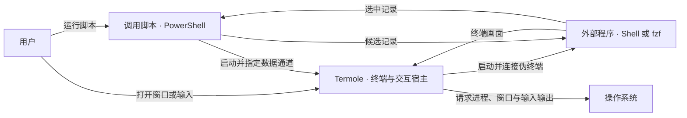
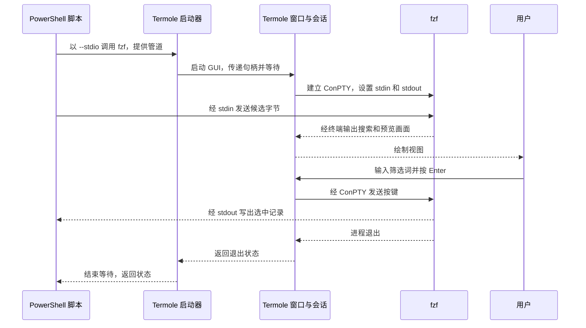

# Termole 程序设计

## 1. Termole 解决什么问题

在 Windows 便携包的根目录运行 `.\bin\termole.exe`，会打开一个能输入命令的 Shell 窗口。另一个入口是 `.\share\termole\examples\select-file.ps1`。这个 PowerShell 脚本列出文件，在窗口中运行外部选择器 fzf，等用户预览、选择后，将选中文件的完整路径交回调用方。第二种窗口称为 **TUI Applet**。两种入口共用终端显示与输入能力。[快速开始](../README.md) · [术语表](../GLOSSARY.md)

图中“候选记录”和“选中记录”两条线只用于文件选择场景。脚本知道目录和文件名，fzf 知道用户选中了哪条记录。Termole 为二者接好管道，同时让用户在独立窗口里与 fzf 交互。窗口里的每次重绘都可以与脚本最终收到的结果分别观察。[CLI 数据通道](cli.md#数据通道语义)

## 2. 仓库实际构建什么

| 平台和预设 | CMake 目标与产物 | 默认设置及平台能力 |
| --- | --- | --- |
| Windows x64，`windows-mingw` | `termole_app` 生成 `bin/termole.exe`，`termole` 生成静态 SDK，安装后通过 `Termole::termole` 链接 | Debug。默认视图（View）用 Direct2D 绘制、DirectWrite 排字。实验 C/GDI 入口随 `TERMOLE_BUILD_C_GUI=ON` 编译，用 `--c-gui` 单独启动。普通启动仍使用默认视图。 |
| Windows x64，`windows-mingw-release` | 同一程序和 SDK，`package` 目标生成便携 ZIP | Release 预设显式设 `TERMOLE_WITH_QUICKJS=ON`。通用 Windows 源码构建默认关闭此开关。独立程序支持 `-e`、`--stdio`、本地会话服务。 |
| Linux，`linux-static`、`linux-musl` | 无界面的 `termole_core_linux`、POSIX PTY、会话和本地通信静态库 | `TERMOLE_BUILD_SDL_GUI` 默认关闭。`linux-musl` 需要对应工具链和针对 musl 的 VT 静态库。 |
| Linux，`linux-gui` | 同一无界面实现加 `termole_sdl`，可执行文件名为 `termole` | 预设打开 SDL3/FreeType 窗口，使用 X11。支持独立 Shell、指定程序和本地会话的服务端及客户端。 |
| macOS，`macos-static` | `termole_core_macos`、POSIX 静态库以及同一个 SDL 窗口目标 | 预设打开 SDL3/FreeType，链接 macOS 系统框架。终端会话与 Linux 共用 POSIX 实现。 |

三个平台都通过 `src/vt/termole_vt.c` 使用 libghostty-vt 1.0.1 解释终端控制序列。根 `CMakeLists.txt` 接入 Windows 静态库，`cmake/TermolePosix.cmake` 接入 Linux 静态库或 macOS XCFramework。窗口依赖 SDL 3.4.20 和 FreeType 2.14.3 的版本固定在 `cmake/TermoleSDL.cmake`，Windows 脚本引擎 QuickJS 2026-06-04 由 `cmake/TermoleQuickJS.cmake` 接入。fzf 由用户单独安装。[构建手册](cross-platform-build.md) · [第三方声明](../THIRD_PARTY_NOTICES.md)

## 3. 一个终端如何工作

一段子程序输出先要成为屏幕上的单元格，再成为像素。**会话（Session）**持有子进程的伪终端（PTY）和 VT 核心，即使暂时没有视图，也能继续接收输出。视图负责当前窗口里的绘制和输入。

1. **读取输出。** Windows 的 `WindowsPty` 为进程连接 ConPTY，`NativeSession::read_loop` 从输出管道读取字节。Linux/macOS 的 `spawn_posix_pty` 建立主从端，把子程序的标准流接到从端。父进程的 `PosixSession::read_loop` 经主端读取字节。两条路径都在会话锁内调用 `termole_vt_feed`。
2. **形成画面。** 共享 VT 核心处理文本和控制序列，维护字符、颜色、光标、主屏与备用屏以及回滚历史。Windows 的 `NativeSession::snapshot` 按视图的回滚位置取出一屏，包括宽字符及其后续单元格。默认视图在 `NativeView::paint_client` 中叠加选区，再由 `Renderer::paint` 绘制。POSIX 的 `PosixSession::frame_after` 在版本变化时复制当前帧，SDL 窗口读取该副本并用 FreeType 绘制字形。
3. **确定状态归属。** 回滚的内容属于会话的 VT。Windows 默认视图持有自己的 `scroll_offset_` 和选区端点，向上浏览历史不会改变子程序的光标。SDL 窗口用 `FrameSelection` 保存当前帧上的选区。可用的历史行和用户此刻看到的行是两个不同的值。
4. **送回输入。** 用户按方向键时，Windows 的 `NativeSession::send_key` 和 SDL 窗口的按键处理都会读取应用光标键模式，再向 PTY 写入对应字节。Windows 默认窗口、IPC 客户端与 SDL 将逻辑键交给 `src/core/input.c` 编码。方向键和 Home/End 根据应用光标模式选择序列。各视图读取平台剪贴板后，复用同一段 C 逻辑为括号粘贴加上起止序列。终端对查询序列的自动应答也走 PTY 的写入方向，核心通过 `termole_vt_callbacks.write_pty` 将应答交给会话。POSIX 会话的读线程继续排空子程序输出，写线程将排队的应答送回子程序。会话将排队的应答和写线程尚未送入 PTY 的字节合计限于 1 MiB。新应答使总量超限或分配内存失败时，会话关闭 PTY 并结束子程序。

Windows 上的 fzf 会先隐藏光标，再分段改写备用屏，最后恢复光标。默认视图在连续的短间隔输出期间保留上一幅完整画面，恢复光标后显示新画面。保留期间，窗口截图、读取可见文本和鼠标选区都使用已绘制的网格；请求截图不会提前切换窗口的画面。从主屏向上滚动后进入备用屏时，视图按备用屏实际可用的历史行数定位。

隐藏光标的程序也可能持续运行。若输出停顿 100 毫秒，视图恢复刷新。若输出仍然连续，视图每 500 毫秒检查上一幅画面中仍在原位的文字。旧字继续减少时延长等待；数量不再下降时恢复绘制。因此持续更新计数器的程序也可以刷新。窗口重绘和截图不会延长输出的计时。

**实验 C 视图如何画准选区？** `src/gui/cview.c` 每次绘制调用一次私有接口 `termole_session_read_viewport`（`src/session/viewport.h`）。会话在同一把锁内复制网格尺寸、单元格、光标和当前视口的文档行范围。视图拥有这份副本，后续输出和缩放不会改变正在绘制的帧。

会话将回滚偏移限制在当前可用历史行数内。向上滚动时，视口先显示历史行，再接上当前屏幕的行，并隐藏实时光标。鼠标拖出窗口时，C 视图将端点限制在已绘帧的行列内，再加上该帧的首个文档行号 `first_document_row`。绘制时按同一行号定位选区，交给 GDI 着色。从主屏切到没有历史的备用屏后，窗口第二行就对应备用屏第二行。

修改各平台共用的 VT 行为，从 `include/termole/core.h` 和 `src/vt/termole_vt.c` 入手。C 接口使用字节、单元格和状态码。平台实现用 C++ 管理管道和线程的寿命，例如 `WindowsPty` 取得句柄后立即交给资源对象，部分初始化失败时由析构函数释放。若单元格已经正确，只有 Windows 默认窗口缺字或选区出现缝隙，先检查 `src/view/view.cpp` 交给 `src/view/renderer.cpp` 的快照和设备像素坐标。[跨平台 C 核心决策](adr/0016-portable-c-core.md) · [共享 VT 与视图决策](adr/0008-libghostty-vt-mingw-c-core.md)

## 4. 一次调用如何结束

在 Windows 文件选择示例里，`termole.exe` 的启动器（Launcher）先检查标准输入和输出已重定向，再用同一可执行文件启动内部 GUI 角色。GUI 为 fzf 建立 ConPTY，并把调用方管道的可继承句柄交给 fzf。时序图里的 PowerShell 指运行示例的脚本。

**结果字节直接从 fzf 的 stdout 到脚本，全程绕过渲染器。** 预览、提示和重绘留在终端通道。脚本检查退出状态和选中记录，再组合出完整路径。Termole 自身的诊断写到调用方 stderr。示例分别由 `examples/select-file.ps1` 和 `examples/preview-file.ps1` 实现。[数据通道决策](adr/0006-terminal-selector-boundary.md) · [等待与退出码](cli.md#等待与退出码)

| 场景 | 谁等待，谁取得结果 | 关窗后谁继续运行，谁清理 |
| --- | --- | --- |
| Windows 普通启动 | 启动器成功启动 GUI 后即返回 0。GUI 持有自己的会话。 | 关闭独立窗口时，GUI 结束该会话并释放视图。其他独立窗口拥有自己的会话。程序先结束时，由窗口退出策略决定是否保留结果画面。 |
| Windows `-e` | 调用方等启动器，启动器等 GUI。程序的三个标准流均连接终端，正常退出后转交程序状态。 | 提前关闭窗口会回收本次会话，调用方得到 130。 |
| Windows Applet 取消 | 按 Esc 时由 fzf 结束选择并返回取消状态。子程序仍在运行时关窗，由 GUI 返回 130。 | 会话负责回收本次子进程。文件选择脚本在 `finally` 中清理临时索引，取消时不输出文件路径。 |
| Windows 嵌入视图销毁 | 嵌入宿主（Embedding Host）在自己的 UI 线程销毁子视图，可以继续持有会话。 | 有会话句柄时 Shell 可继续运行，并可重新附加视图。宿主可显式终止会话，最后释放会话引用时库负责清理进程。 |
| 本地会话客户端关闭 | 一个端点由服务端持有一个会话。客户端通过 Windows 命名管道或 Unix 域套接字获取帧、发送输入、查询退出状态。 | 普通客户端断开后，服务端退出并回收子进程。`--client --detach` 断开后保留服务端和会话，下一个客户端连接同一端点即可接续。 |
| Linux/macOS 独立窗口关闭 | SDL 进程运行窗口事件循环。子程序先结束时，程序取回其退出状态。 | 关窗时本地 `PosixSession` 停止读线程，PTY 实现终止前台进程组和 Shell 组，并等待子进程。 |

进程清理的实现入口是 Windows 的 `NativeSession::terminate` 和 `WindowsPty::terminate_process`，以及 POSIX 的 `PosixPtyBackend::close`。Windows 使用 Job Object 管理本次进程树。若宿主策略阻止进程加入 Job，代码退回到终止直接子进程，这种环境需单独核查后代进程。[窗口与会话决策](adr/0010-window-definitions.md) · [本地会话用法](cli.md#本地会话)

## 5. 宿主与扩展如何接入

| 接口 | 调用方与所有权 | 线程、寿命与错误 |
| --- | --- | --- |
| 可移植 VT C ABI 1，`include/termole/core.h` | 会话创建和释放 `termole_vt`。`termole_vt_frame` 借出 VT 自己持有的帧与单元格。 | 改变终端或再生成一帧后，旧指针失效。会话在锁内使用或复制数据，绘制线程使用副本。可失败操作返回 `termole_core_status`。 |
| Windows 嵌入 SDK ABI 3，`include/termole/termole.h` | 宿主提供父窗口，创建会话和子视图。视图持有会话引用，一个会话同时附加一个默认嵌入视图。`termole_session_snapshot` 将单元格复制到调用方缓冲区，库分配的文本用 `termole_free` 释放。 | 会话操作内部同步，销毁句柄时须与其他调用错开。视图操作在父窗口的 UI 线程运行。入口返回 `termole_status`，通过 `termole_last_error` 读取当前线程的诊断。 |

`examples/sdk-host` 展示如何用已安装的 SDK 将终端放进应用自己的窗口。Windows 独立入口则负责读 TOML。它从内置默认值开始，依次应用根配置、选中的配置组（Profile）和显式 CLI 参数。宿主也可自行选取配置来源并传入 SDK 选项。[SDK 手册](sdk.md) · [配置优先级](config.md#文件位置与优先级)

同一个选区可以触发两种扩展。**管道动作（Pipe action）**由配置绑定快捷键，例如 `[pipe.selected]`。触发后 `run_pipe_action` 取得选区文本，`PipeRunner` 将 UTF-8 写入外部命令的 stdin，命令的 stdout、stderr 被丢弃。**本地 JavaScript 插件**通过全局 `plugins` 项启用。随包示例 `markdown-quote.toml` 指向同目录的 `markdown-quote.js`。它注册一个右键命令，调用 `termole.getSelection()` 读取打开菜单的视图选区，为每行加上 `> `，再调用 `termole.writeClipboard()` 暂存结果。回调成功返回后，GUI 才将文本提交到系统剪贴板。未启用插件时，独立终端无需为它创建运行时。[管道动作配置](config.md#pipe-动作按键) · [本地插件示例](config.md#本地-quickjs-插件)

## 6. 如何查证设计

源码路径均相对仓库根目录。表中的名称可在 CTest 清单中检索。`<平台>` 在 POSIX 测试名中取 `linux` 或 `macos`。视觉测试的 PNG 和像素统计位于对应构建目录的 `tests/visual/` 下。[验证指南](agents/testing.md)

| 读者的问题 | 源码入口与符号 | 契约或像素证据 | 设计理由 |
| --- | --- | --- | --- |
| 控制序列如何改变屏幕和光标？ | `src/vt/termole_vt.c` 的 `termole_vt_feed`、`termole_vt_frame`、`termole_vt_modes`。Windows 的 `termole_session_get_modes` 从会话取得模式。 | `vt_adapter_contract`、`vt_adapter_<平台>` 检查单元格和模式。`c_abi_characterization` 经 Windows C 接口读取备用屏状态，`visual_alt_screen` 检查窗口中的文字像素。 | [ADR 0008](adr/0008-libghostty-vt-mingw-c-core.md) |
| Windows 选择、粘贴和绘制要改哪里？ | `src/view/view.cpp` 的 `NativeView::paste`、`paint_client`，`src/view/renderer.cpp` 的 `Renderer::paint`。 | `visual_input_interaction`、`visual_input_standalone` 核对子程序收到的字节与窗口像素。 | [ADR 0008](adr/0008-libghostty-vt-mingw-c-core.md) |
| 实验 C 视图如何避免缩放或切屏时选错行？ | `src/session/session.cpp` 的 `NativeSession::read_viewport`，`src/gui/cview.c` 的 `paint` 和 `document_cell_at`。 | `tests/visual/cview_test.cpp` 对应 `cview_contract`。它在滚动后的主屏将鼠标拖出底边和右边，再在备用屏第二行拖选，核对两次选中的文本与高亮像素。截图在构建目录的 `tests/visual/cview/` 下。它也在并发缩放时检查网格与首行。`cgui_visual` 检查独立实验窗口。 | [ADR 0008](adr/0008-libghostty-vt-mingw-c-core.md) |
| fzf 的选择结果、取消和窗口清理如何验证？ | `apps/standalone/main.cpp` 的 `run_launcher`，`apps/standalone/gui.cpp` 的 `window_proc`，`src/platform/windows_pty.cpp` 的 `WindowsPty` | `t26_cli_pipelines` 核对真实管道字节，`t26_launcher` 核对退出状态、关窗取消与子进程退出。`visual_fzf_standalone` 捕获真实 fzf。 | [ADR 0006](adr/0006-terminal-selector-boundary.md) · [ADR 0007](adr/0007-console-launcher-wait.md) |
| 如何检查 POSIX 终端、重连或嵌入视图的寿命？ | `src/platform/posix_session.cpp` 的 `PosixSession::read_loop`，`src/ipc/session_ipc.cpp` 的 `serve_connection`，`src/api/api.cpp` 的 `termole_view_destroy` | `posix_interactive_<平台>` 从子程序验证光标位置应答。`session_ipc_windows`、`session_ipc_<平台>` 验证重连。`t22_sdk_consumer` 从安装目录构建宿主，销毁视图后重新附加到同一会话。 | [ADR 0010](adr/0010-window-definitions.md) · [ADR 0017](adr/0017-native-embedding.md) |
| 配置和脚本怎样影响当前视图？ | `apps/common/config.cpp` 的 `load_config`，`apps/standalone/gui.cpp` 的 `run_pipe_action`、`show_selection_menu`，`src/script/script.c` 的 `termole_plugin_invoke` | `t14_cli_config` 检查覆盖次序，`t25_pipe_e2e` 检查单向文本。`script_abi_stub` 在启用 QuickJS 时测试示例输出和异常时丢弃剪贴板文本。 | [ADR 0006](adr/0006-terminal-selector-boundary.md) · [ADR 0018](adr/0018-quickjs-plugins.md) |

**实现与计划。** 上述终端、数据通道、嵌入、重连及按开关构建的视图和插件均有源码入口。ADR 0017 还采纳了按视图调整内边距、分别覆盖或撤销三种颜色的设计。当前 ABI 3 的 `termole_appearance` 只提供字体、字号和主题，相应的细粒度设置仍待实现。替换默认 Windows 视图需另行完成两种实现的输入法、回滚、选区和绘制对照验收。[视图定制决定](adr/0017-native-embedding.md) · [视图验收条件](adr/0008-libghostty-vt-mingw-c-core.md)

**核对基准。** 在提交 `adbc611ece92` 中，Windows 默认视图已通过 `NativeView::paste` 处理括号粘贴，实验 C 视图通过 `termole_session_snapshot` 读取单元格，再单独查询光标。可以在该提交的 `src/view/view.cpp`、`src/gui/cview.c` 核对这两条调用链。后续提交 `7bc9468` 接通 POSIX 终端应答，`f2ed36b` 为 Windows 实验视图增加同帧读取，并修正备用屏状态查询。

**默认视图的输入与绘制。** 提交 `64fbbc6` 固定了单击清除选区、由 Windows 默认窗口过程提交输入法字符、选区背景对齐设备像素的实现。消息转发由 `t01_host_api` 验证，Ctrl+C 的去向和跨行选区颜色由 `visual_input_interaction`、`visual_input_standalone` 检查。真实输入法选词和焦点依照 [#53](https://github.com/Coh1e/termole/issues/53) 另行记录。

历史记录 `docs/fzf-blank-validation.md` 对应 2026-10-31 的 Windows 11 x64、MSVC Release、150% 缩放、fzf 0.74.5，保留了当时的截图及候选行和指针行的像素统计。当前包的验收需对应其实际构建和测试产物。[历史像素记录与截图](https://github.com/Coh1e/termole/blob/b15c73d117e0b8a79e06fa04d1a15d8879be4d74/docs/fzf-blank-validation.md)

本文按 arc42 的结构与运行场景组织，并依 C4 的层次先说明外部角色，再展开程序内部的协作。[arc42 结构说明](https://arc42.org/overview/) · [C4 架构视图](https://c4model.com/diagrams)
