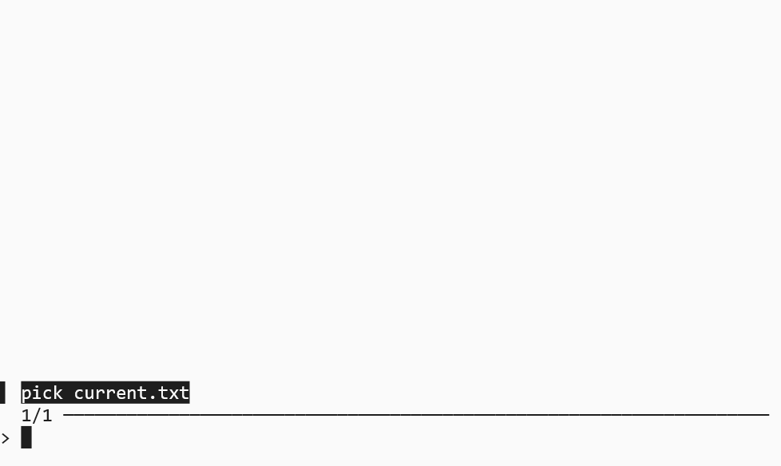
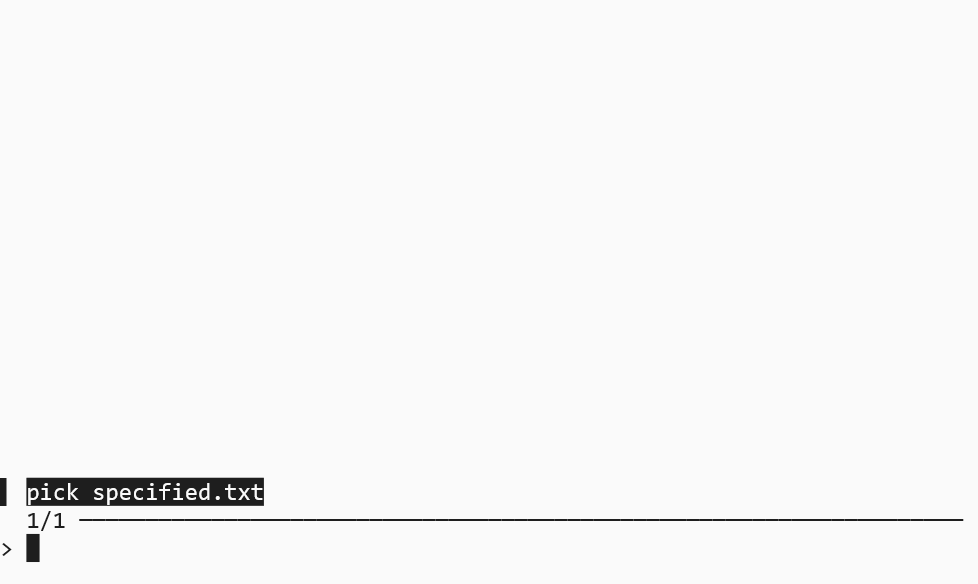

# Windows PowerShell file selection (#38)

Windows 11 x64 26H2, build 26300.10075. Windows PowerShell 5.1.26100.10068
and separately installed fzf 0.75.0 (c7bf2b8e). The Release build used
MinGW GCC 16.2.0. CPack produced `Termole-0.1.0-win64.zip`, SHA-256
`35d3a12ea2066f1d5a1f7af8d7c906613b505a3444e65d44fa80dc0732f7cad6`.
This machine had CMake 3.22.1. For this run only, a temporary source copy
lowered the top-level CMake version requirement to 3.22 and used Ninja.

Extracted the archive under `便携 包`. Verified the archive contains
`bin/termole.exe`, `share/termole/examples/select-file.ps1`, the project
LICENSE, THIRD_PARTY_NOTICES.md and the bundled libghostty-vt license.

Each directory contained one direct file and a nested directory with a
second file. Launched the extracted script in a Windows PowerShell process,
captured its two streams separately, and sent Enter to its real Termole View.

| Invocation | Visible candidates | Exact stdout line | stderr | Exit |
| --- | --- | --- | --- | --- |
| Current directory | 1 | `D:\workspace\spec38-example\.local\interactive-current\pick current.txt` | empty | 0 |
| Explicit directory | 1 | `D:\workspace\spec38-example\.local\interactive-specified\pick specified.txt` | empty | 0 |

Each stdout line ended in CRLF. The captured frames immediately before Enter
show the current-directory and explicit-directory selections respectively.

The package test in `tests/run_file_example.ps1` also ran against this
extraction. Using fzf's filter mode, it checked a Unicode filename in a
directory with literal brackets, and exclusion of directories, descendants
and files from the invoking directory when another directory was specified.
