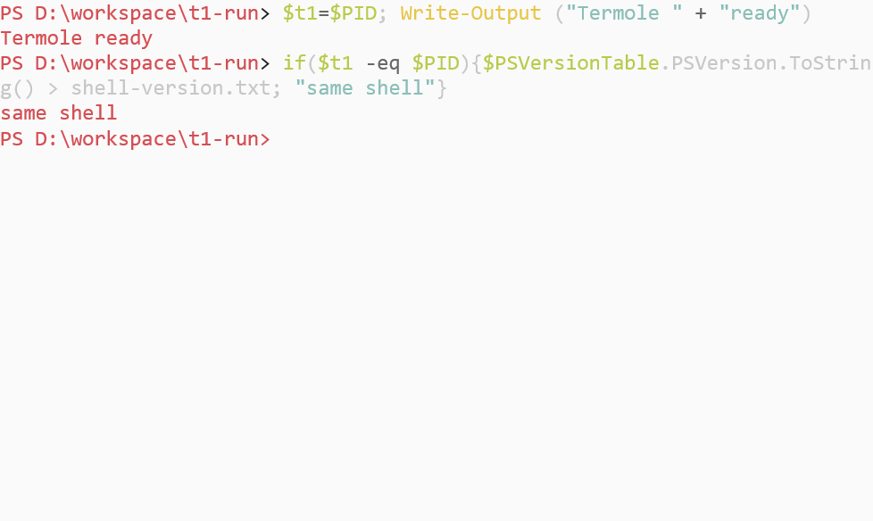

# Windows standalone default Shell (#33)

Verified on Windows x64 build 26300.10075 with PowerShell 7.6.9.
The executable came from the existing MinGW Debug build, SHA-256
`97d1404d836c2e2e7c64b755acd0c8cad009941028c2c550ebe1670ac3067d2b`.
This run did not rebuild it. No selector participated.

Started the product executable without arguments from a working directory
containing a fresh, empty directory used as `APPDATA`. The launcher returned
and the GUI process created a `TermoleStandaloneWindow` containing a
`TermoleViewWindow`. The initial capture showed PowerShell and its prompt.
PSReadLine reported denied access to the host history file. For the following
captures, a command in that Shell disabled history saving and cleared the
screen. No Termole configuration file was created.

Through the View's character and Enter messages, entered these two commands:

```powershell
$t1=$PID; Write-Output ("Termole " + "ready")
if($t1 -eq $PID){$PSVersionTable.PSVersion.ToString() > shell-version.txt; "same shell"}
```

The first command printed `Termole ready` on its own line. The second read
the variable set by the first, wrote `7.6.9` to the version file and printed
`same shell`. A fresh prompt followed. The final real View capture measured
978 × 584 pixels, including 15,493 non-background pixels.


