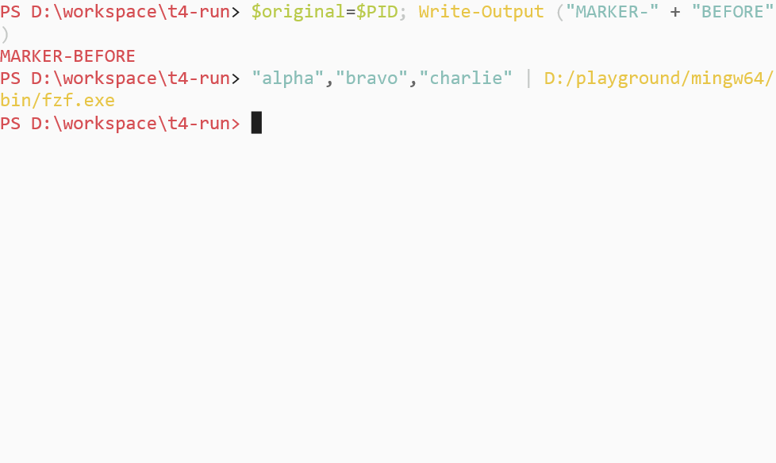
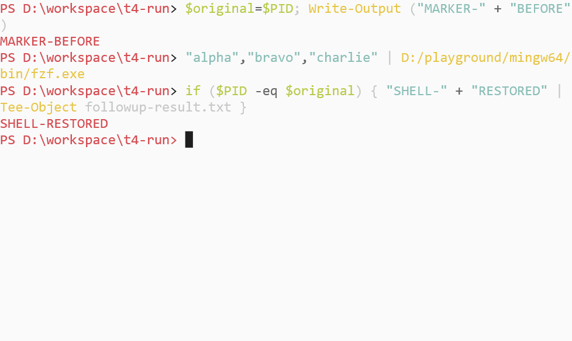

# Windows standalone fzf cancellation (#36)

Windows x64 build 26300.10075, PowerShell 7.6.9, fzf 0.75.0 (c7bf2b8e).
Used the same MinGW Debug executable recorded in [T1](standalone-t1-windows.md).
Launched without arguments with a fresh APPDATA directory. In the default
Shell, disabled PSReadLine history saving and cleared the screen.

Entered the following commands through the standalone View:

```powershell
$original=$PID; Write-Output ("MARKER-" + "BEFORE")
"alpha","bravo","charlie" | D:/playground/mingw64/bin/fzf.exe
```

Typed `bra`. The fullscreen selector showed `bravo` as the only match (1/3).


Pressed Esc through the View. The marker line reappeared, the selector rows
cleared, and the block cursor appeared after the PowerShell prompt.



Entered a command guarded by the PID saved before fzf:

```powershell
if ($PID -eq $original) { "SHELL-" + "RESTORED" | Tee-Object followup-result.txt }
```

The command and its output appeared above a fresh prompt. The result file
contained the single line `SHELL-RESTORED`.


