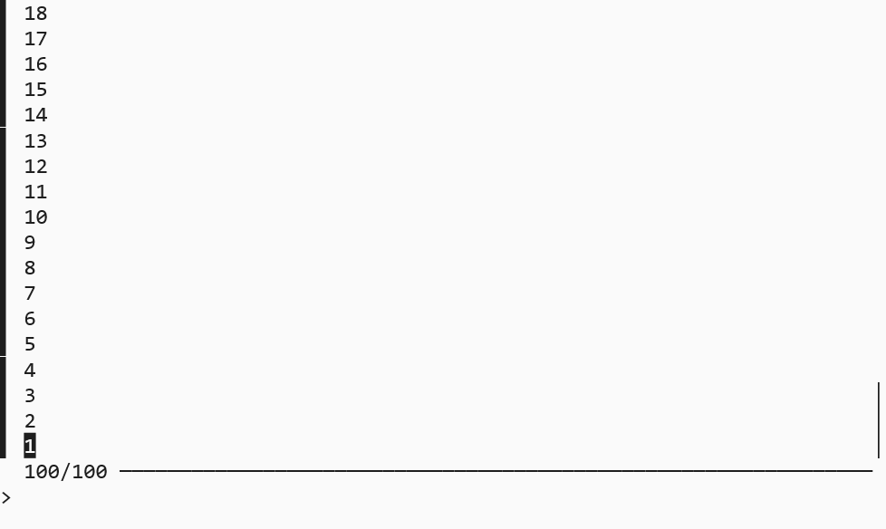
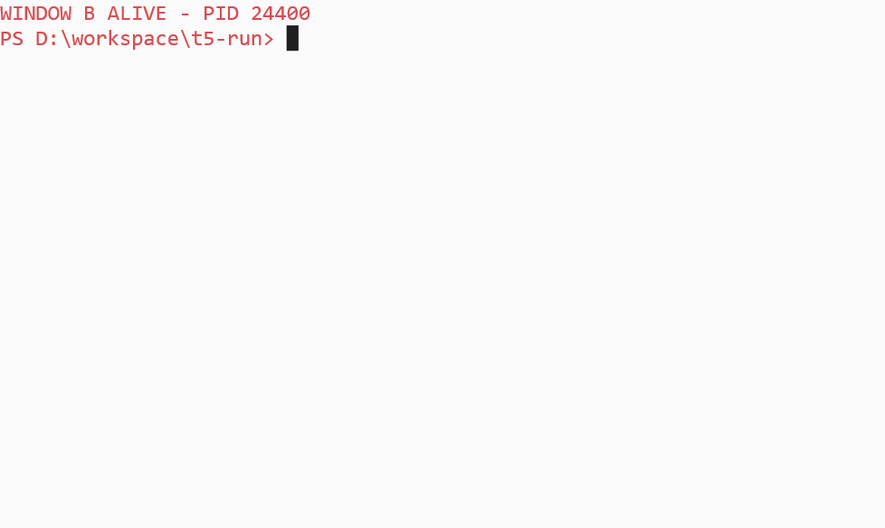

# Two independent Windows terminal windows

On 2026-11-21, two ordinary no-argument launches of the same MinGW Debug
termole.exe opened separate TermoleStandaloneWindow windows. Each had its
own TermoleViewWindow. Both shells used the same temporary working
directory and the same APPDATA without a Termole configuration file.

| Process | Window A PID | Window B PID |
| --- | ---: | ---: |
| Standalone window | 8716 | 13132 |
| Original PowerShell (reported by the shell via $PID) | 1584 | 24400 |
| Interactive fzf | 13572 | |

Window A ran `1..100 | D:/playground/mingw64/bin/fzf.exe`. Its fzf PID
was newly created and its parent PID matched the recorded shell PID.
Window B saved its own PID in a shell variable. With fzf still running,
the driver posted WM_CLOSE to window A. Exit waits on the three original
process objects (A, its shell and fzf) all succeeded within the eight-second
per-process timeout.

After those exits, the driver sent the following command through window B:

```powershell
if($orig -eq $PID){Clear-Host; "WINDOW B ALIVE - PID $PID"; "alive $PID" > survived3.txt; $PSVersionTable.PSVersion.ToString() > psver.txt}
```

The newly created file contained `alive 24400`. The driver then closed
window B. This run covers Windows only.

The first capture shows fzf with 100/100 entries in A before WM_CLOSE.
The second shows B printing `WINDOW B ALIVE - PID 24400` and returning
to the PowerShell prompt after all three exit waits succeeded.





Windows NT 10.0.26300.0, PowerShell 7.6.9, fzf 0.75.0 (c7bf2b8e).
MinGW Debug executable SHA-256:
`97D1404D836C2E2E7C64B755ACD0C8CAD009941028C2C550EBE1670AC3067D2B`.
